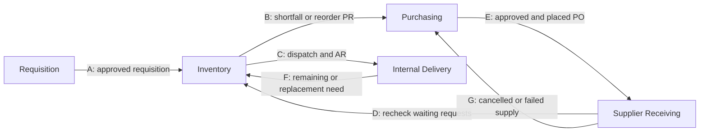
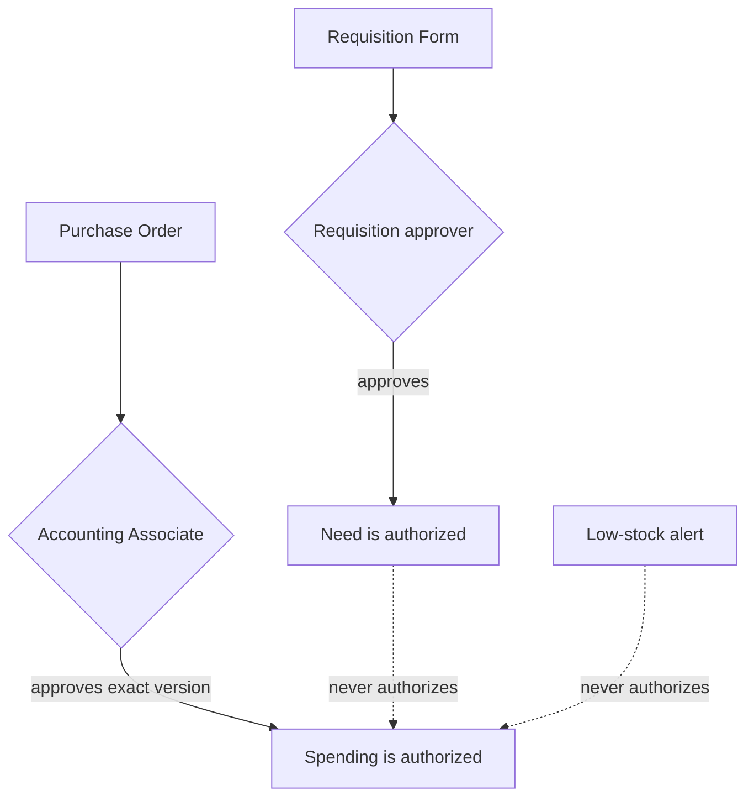
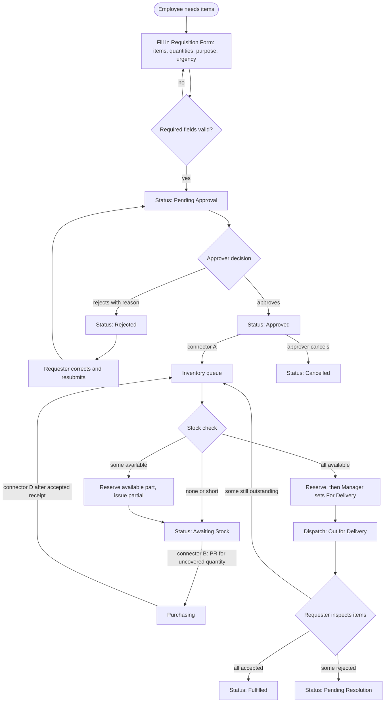
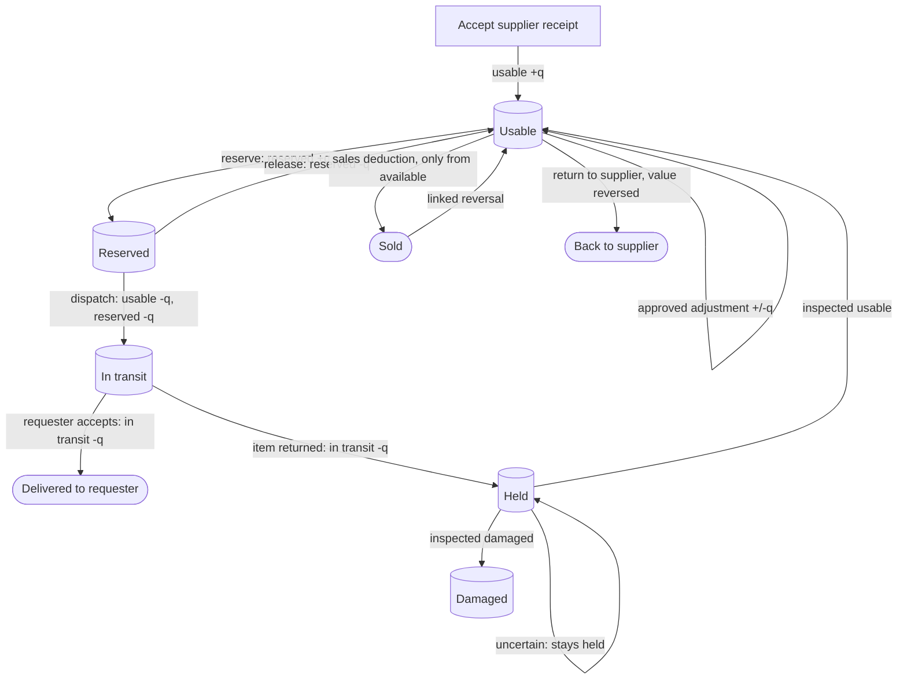
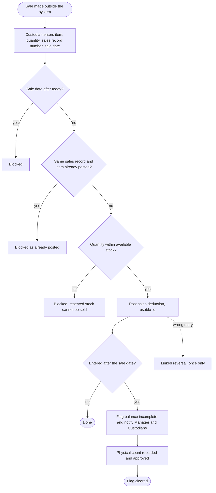
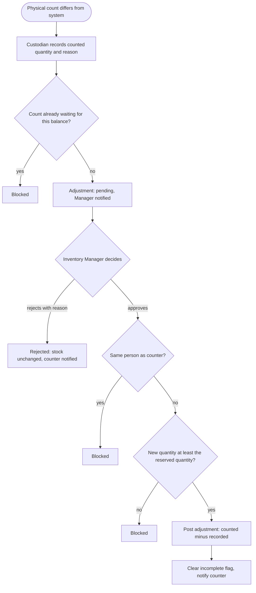
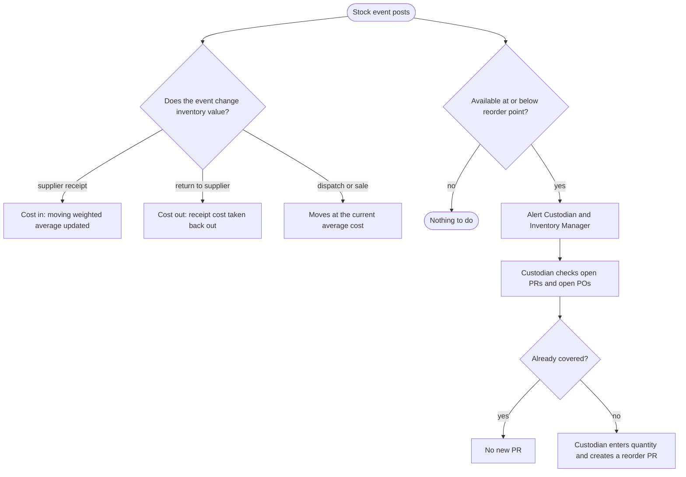
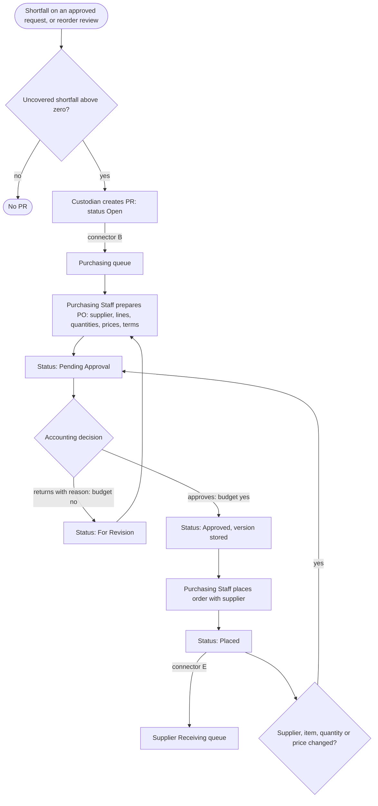
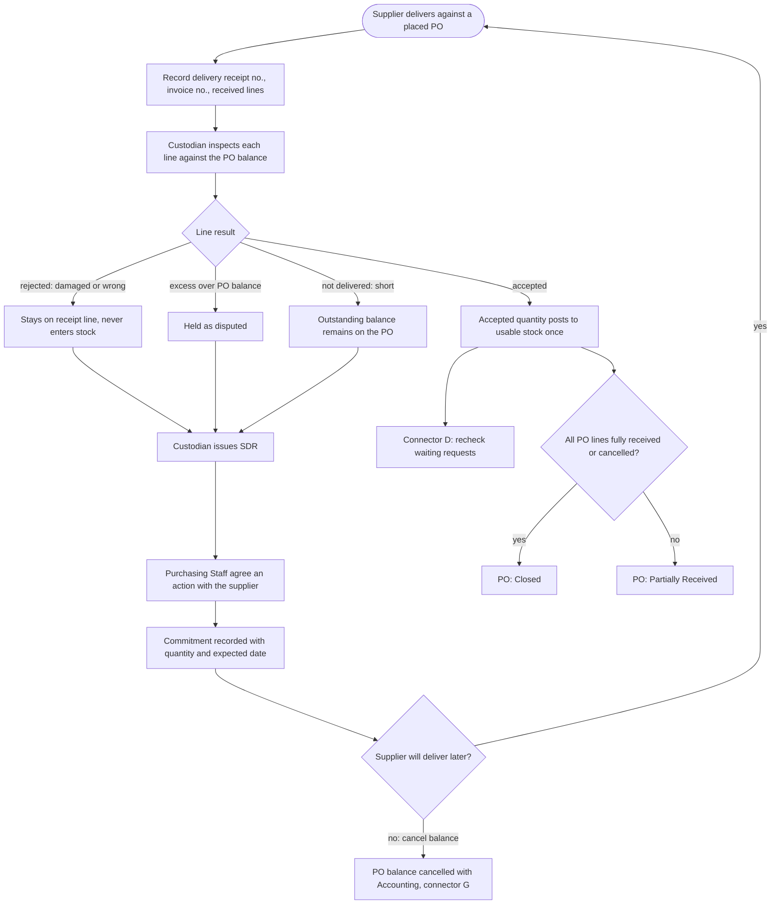
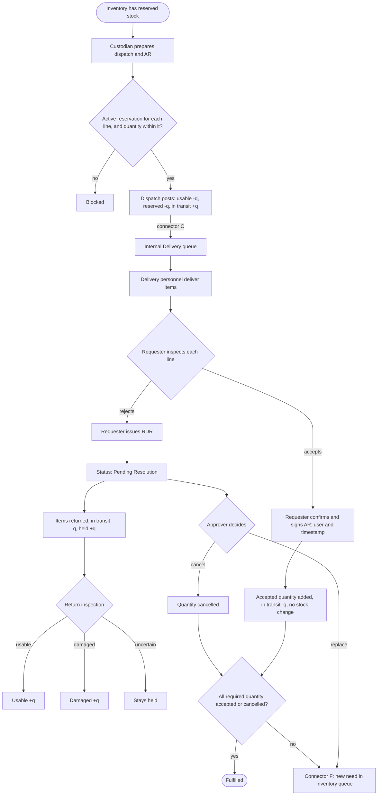

# RCWheels Business Rules

The business rules of the RCWheels Business Management System, with a flowchart for each process they govern. Read it with [PLAN.md](PLAN.md) (scope, decisions, stock events) and [ERD.md](ERD.md) (tables).

## How to read this document

**Sources.** The rules come from the client's problems and current workflow as the team recorded them in `Proposal_Revised.pdf` (including its seven figures) and the October 10 background and October 14 interview notes. [PLAN.md](PLAN.md) condenses those sources. If a rule here disagrees with the proposal, the proposal wins.

**Rule IDs.** Each rule has an ID (`BR-<area>-<n>`) so code, tests, and the user guide can cite it.

**Basis column.**

| Basis | Meaning |
| --- | --- |
| Proposal | Stated in the proposal or the client interviews |
| Decision N | One of the prototype decisions in PLAN section 3 |
| Plan rule N | One of the "Rules to enforce in code" in PLAN section 7 |
| Proposed | Added by the team to make the process complete; not stated by the client |

**Status column.** `Built` means the rule is enforced in code today (phases 1 and 2). `Planned` means the rule is in the build plan for a later phase.

**Areas.** AC access, RQ requisition, IN inventory, PU purchasing, SR supplier receiving, DL internal delivery, GN general and audit.

---

## 1. Process overview

Seven connectors (A to G) hand work between the four modules. A connector only creates a queue item or a flag; it never moves stock.

Two separate approvals exist and must never be confused:

---

## 2. Access and accounts (AC)

| ID | Rule | Basis | Status |
| --- | --- | --- | --- |
| BR-AC-01 | Every person uses an individual account with exactly one role. Shared logins are not allowed. | Proposal | Built |
| BR-AC-02 | The roles are: requester, requisition approver, Inventory Custodian, Inventory Control or Monitoring Manager, Purchasing Staff, Accounting Associate, Delivery or Operations personnel, and system administrator. Each role sees only its own screens and actions. | Proposal; administrator is a prototype addition | Built |
| BR-AC-03 | The server checks the role on every action. The browser's claim about who the user is, their role, or a stock figure is never trusted. | Proposal | Built |
| BR-AC-04 | An action or screen refused for role reasons is blocked and written to the audit log. | Plan rule 12 | Built |
| BR-AC-05 | Mechanics have their own accounts and sign their own Acknowledgement Receipts. | Decision 2 | Planned |
| BR-AC-06 | A user cannot approve their own requisition, PO, or stock count. | Plan rule 11 | Built for stock counts; Planned for requisitions and POs |
| BR-AC-07 | Each requester has an assigned approver, and requests route to that person. The approver is a manager, department head, or boss. | Decision 6 | Planned |
| BR-AC-08 | Only the system administrator creates accounts, assigns roles, and deactivates users. A deactivated user cannot sign in, and their history stays. | Proposed | Planned |
| BR-AC-09 | Credentials are owned by Supabase Auth. The system stores no passwords. | Technical approach | Built |

### Who may do what

| Action | Role |
| --- | --- |
| Create a requisition, track own requests, accept items, sign an AR, issue an RDR | Requester |
| Approve or reject a requisition, mark Fulfilled, cancel a remaining request balance, decide replacement or cancellation | Requisition approver |
| Verify stock, reserve, prepare ARs, create PRs, record sales deductions, record stock counts, inspect receipts and returns, issue SDRs | Inventory Custodian |
| Approve or reject stock counts, maintain reorder points, set For Delivery, review exceptions | Inventory Control or Monitoring Manager |
| Maintain and evaluate suppliers, prepare and place POs, follow up deliveries, record SDR resolutions | Purchasing Staff |
| Approve or return POs with a budget yes or no, authorize PO balance cancellation, approve inventory value changes | Accounting Associate |
| Assist receiving, deliver items, return rejected items | Delivery or Operations personnel |
| Manage accounts and roles | System administrator |

---

## 3. Requisition (RQ)

| ID | Rule | Basis | Status |
| --- | --- | --- | --- |
| BR-RQ-01 | Only an authorized employee can create a Requisition Form (RF). A form can be submitted on behalf of a mechanic; the system keeps both the submitter and the requester name. | Proposal | Planned |
| BR-RQ-02 | An RF needs at least one line. Each line needs an item from the item list and a quantity above zero (up to 3 decimal places). The purpose is required. | Proposal (required-field validation) | Planned |
| BR-RQ-03 | A request can be marked urgent. Urgency moves it up the queues but does not skip approval, the stock check, or any later step. | Proposal; wording proposed | Planned |
| BR-RQ-04 | A submitted RF starts as Pending Approval and goes to the requester's approver. | Decision 6 | Planned |
| BR-RQ-05 | The approver approves or rejects. A rejection needs a reason. The approver may approve less than the requested quantity; the approved quantity is stored separately from the requested quantity. | Proposal; reason and partial approval proposed | Planned |
| BR-RQ-06 | A rejected RF can be corrected and resubmitted. The earlier decision stays in the status history and approval runs again. | Test scenario 11 | Planned |
| BR-RQ-07 | An approved RF appears in the Inventory queue (connector A). Nothing is reserved until the Custodian verifies the stock. | Proposal | Planned |
| BR-RQ-08 | The RF status only summarizes the line quantities. Each line tracks requested, approved, reserved, dispatched, accepted, returned, cancelled, and outstanding quantities. The line quantities are what the system relies on. | PLAN section 7 | Planned |
| BR-RQ-09 | Unissued need = approved - accepted - in transit. Approved here excludes any separately cancelled quantity. | PLAN section 7 | Planned |
| BR-RQ-10 | Inventory Control or Monitoring Manager sets For Delivery. The requisition approver marks Fulfilled. | Decision 5 | Planned |
| BR-RQ-11 | A requisition becomes Fulfilled only when every required quantity is accepted, or the remaining balance is separately cancelled. | Plan rule 5 | Planned |
| BR-RQ-12 | A supplier receipt alone never fulfills a requisition. | Plan rule 4 | Planned |
| BR-RQ-13 | The requisition approver can cancel a remaining request balance. Cancelling a requisition does not cancel a PO. | Plan rule 6 | Planned |
| BR-RQ-14 | A delivery rejection puts the request in Pending Resolution. It never changes an approved request to Rejected. | Plan rule 7 | Planned |
| BR-RQ-15 | Every status change writes a status history row with who, when, from, to, and reason. | ERD | Planned |
| BR-RQ-16 | Approving a requisition does not approve a purchase. | Plan rule 1 | Planned |

---

## 4. Inventory and stock (IN)

### 4.1 Stock model

Each item has one balance row per condition, and the balances are `usable`, `damaged`, and `hold`.

- **Available = usable on hand - active reservations.**
- Reserved quantity is derived from active `stock_reservations`.
- In-transit quantity is derived as sent - accepted - returned on `dispatch_lines`.
- Neither is stored on the balance, so they cannot drift.

### 4.2 Stock events

| ID | Rule | Basis | Status |
| --- | --- | --- | --- |
| BR-IN-01 | Only `stock.service.ts` changes stock balances. No screen, action, or other module writes a balance. | Plan section 4 | Built |
| BR-IN-02 | Every stock event has a unique source reference (`event_key`), so the same event posts only once. A second attempt is refused as already posted. | PLAN section 7 | Built |
| BR-IN-03 | Quantities are numbers above zero with up to 3 decimal places. They are handled as whole thousandths, with no floating-point arithmetic. | Technical approach | Built |
| BR-IN-04 | Stock is deducted once, at dispatch. A requester's acceptance deducts nothing. | Plan rule 3 | Built |
| BR-IN-05 | Accepted supplier receipts post usable stock once, in Supplier Receiving. Connector D only flags waiting requests for recheck and never posts stock. | Plan rule 3; connector D | Built (posting); Planned (flag) |
| BR-IN-06 | A reservation cannot exceed available stock. | PLAN section 7 | Built |
| BR-IN-07 | Stock reserved for one request cannot be dispatched to another request or sold. A dispatch line must use an active reservation for the same requisition line. | Plan rule 8 | Built |
| BR-IN-08 | A dispatch cannot send more than the reserved quantity or more than the usable quantity on hand. If a reservation is larger than the sent quantity, the rest stays reserved. | PLAN section 7 | Built |
| BR-IN-09 | A reservation can be released once, and only while it is active. A consumed reservation cannot be released. | PLAN section 7 | Built |
| BR-IN-10 | The `stock_balances` row is locked during reserve and dispatch. When one event touches several items, rows are locked in item ID order, so two requests cannot claim the same stock or deadlock each other. | Plan rule 10 | Built |
| BR-IN-11 | A balance flagged incomplete needs physical verification before stock can be reserved from it. | Plan rule 9 | Built |
| BR-IN-12 | An accepted return goes to Held first. After inspection it moves to Usable or Damaged. An uncertain return stays Held until it is reinspected. | PLAN section 7 | Built |
| BR-IN-13 | Rejected supplier goods never enter the stock balances. They stay on the receipt line. | PLAN section 7 | Built |
| BR-IN-14 | Stock is never edited to correct it. A correction is a linked reversal or an approved adjustment, and the history is append-only. | Proposal; Plan section 7 | Built |

### 4.3 Sales deductions

Sales are processed outside the system. The system only deducts stock against a sales record.

| ID | Rule | Basis | Status |
| --- | --- | --- | --- |
| BR-IN-20 | Only the Inventory Custodian records or reverses a sales deduction. | Proposal; Roles | Built |
| BR-IN-21 | Each sales record line can be posted once per item. | Test scenario 10 | Built |
| BR-IN-22 | A sales deduction cannot exceed available stock. Stock reserved for a request cannot be sold. | Plan rule 8 | Built |
| BR-IN-23 | The sale date cannot be in the future. Dates use the main location's time zone (Asia/Manila). | Proposed | Built |
| BR-IN-24 | A sale entered after its sale date is a late entry. It is posted, flags the balance incomplete, and notifies the Manager and Custodians. | Proposal; test scenario 10 | Built |
| BR-IN-25 | A wrong deduction is corrected by a linked reversal that adds the stock back at the original cost. A deduction can be reversed once. The original row is never edited. | ERD change 4 | Built |

### 4.4 Stock counts and adjustments

| ID | Rule | Basis | Status |
| --- | --- | --- | --- |
| BR-IN-30 | Only the Custodian records a count. The recorded system quantity is captured at the time of the count. | Proposal | Built |
| BR-IN-31 | A balance can have only one pending count at a time. | Proposed | Built |
| BR-IN-32 | A count changes stock only after the Inventory Manager approves it. The person who counted cannot approve it. | Proposal; Plan rule 11 | Built |
| BR-IN-33 | An approved adjustment moves the balance by counted - recorded, posts once, and clears the incomplete flag. A usable balance cannot fall below its active reservations. | Plan rule 9 | Built |
| BR-IN-34 | A rejected count needs a reason, changes nothing, and notifies the person who counted. | Proposed | Built |

### 4.5 Item cost, value, and reorder

| ID | Rule | Basis | Status |
| --- | --- | --- | --- |
| BR-IN-40 | Inventory value uses the moving weighted average cost, updated on accepted receipts. A return to a supplier takes the receipt cost back out. | Decision 4 | Built |
| BR-IN-41 | A supplier return cannot exceed what that receipt line posted (minus earlier returns), or the available stock. | PLAN section 7 | Built |
| BR-IN-42 | Each item has a reorder point, maintained by the Inventory Manager. Every change is audited with the old and new value. | Proposal | Built |
| BR-IN-43 | When available stock is at or below the reorder point, the Custodian and Inventory Manager are alerted in the system. | Proposal | Planned |
| BR-IN-44 | The reorder point triggers a review. It is not the order quantity and never authorizes spending. The Custodian enters the quantity after checking open PRs and open POs. | Plan rule 1; PLAN section 7 | Planned |
| BR-IN-45 | Item codes are unique. A new item opens usable, damaged, and hold balances at zero. | ERD | Built |

---

## 5. Purchasing (PU)

| ID | Rule | Basis | Status |
| --- | --- | --- | --- |
| BR-PU-01 | A PR is created only when the uncovered shortfall is above zero. Uncovered shortfall = approved - accepted - in transit - reserved - allocated outstanding PO quantity. | PLAN section 7 | Planned |
| BR-PU-02 | A PR is either a shortage PR, linked to a requisition line, or a reorder PR, with no requisition line. A PR links to the PO lines that cover it, so demand is not counted twice. | ERD | Planned |
| BR-PU-03 | A PR does not authorize a purchase. Only an approved PO does. | Plan rule 1 | Planned |
| BR-PU-04 | Only Purchasing Staff maintain suppliers and prepare POs. A PO needs a supplier and at least one line with a quantity and a unit price above zero. | Proposal | Planned |
| BR-PU-05 | A new PO starts as Pending Approval and goes to Accounting for review. | Proposal | Planned |
| BR-PU-06 | Accounting decides yes or no on the budget and records a reason. There is no budget table. | Decision 7 | Planned |
| BR-PU-07 | When Accounting returns a PO, it becomes For Revision. Purchasing Staff revise it and send it back to Accounting. | Test scenario 6 | Planned |
| BR-PU-08 | A PO cannot be placed until Accounting approves that exact version. A change to supplier, item, quantity, or price after approval needs reapproval. | Plan rule 2 | Planned |
| BR-PU-09 | Every PO version and its review are kept (`purchase_order_revisions`), including the earlier commitments. Nothing is overwritten. | ERD change 5 | Planned |
| BR-PU-10 | Placing a PO sends it to the Supplier Receiving queue with its expected quantities (connector E). | Proposal | Planned |
| BR-PU-11 | A PO balance is cancelled only with Accounting authorization. Cancelling a PO does not cancel a requisition. A cancelled balance creates a demand review in Purchasing (connector G). The requisition stays open until it is covered or separately cancelled. | Plan rules 6; test scenario 7 | Planned |
| BR-PU-12 | A user cannot approve a PO they prepared. | Plan rule 11 | Planned |
| BR-PU-13 | Purchasing Staff follow up open POs, and the Accounting Associate can see them. | Proposal | Planned |

---

## 6. Supplier receiving (SR)

| ID | Rule | Basis | Status |
| --- | --- | --- | --- |
| BR-SR-01 | Goods are received only against a Placed or Partially Received PO. | Proposal | Planned |
| BR-SR-02 | A receipt records the delivery receipt number, invoice number, who received it, and the delivered quantity per line. Delivery or Operations personnel may assist. | Proposal | Planned |
| BR-SR-03 | The Custodian inspects each line and records accepted quantity, rejected quantity, and notes. Partial acceptance is allowed. | Proposal | Planned |
| BR-SR-04 | Each delivery is checked against the PO line's outstanding balance, not the original ordered quantity. A PO of 10 with 6 accepted has 4 outstanding. | Test scenario 5 | Planned |
| BR-SR-05 | Accepted quantity posts to stock once per receipt line, at the PO line price. Rejected quantity never enters stock. | Plan rule 3 | Built (posting); Planned (receipt screens) |
| BR-SR-06 | A quantity above the PO balance is held as disputed by the Custodian. Purchasing Staff record the resolution. | Decision 8 | Planned |
| BR-SR-07 | A shortage, damage, wrong item, or excess is reported in a Supplier Discrepancy Report (SDR) with the problem, the affected quantity, and a resolution. SDR status is Open, Agreed, then Resolved. | Proposal | Planned |
| BR-SR-08 | An agreed action (replace, follow-up delivery, credit, or cancel) is stored as a commitment with a quantity and an expected date. Later deliveries are checked against it. | Proposal | Planned |
| BR-SR-09 | A PO is Partially Received until every line is fully received or cancelled, then Closed. | PLAN section 7 | Planned |
| BR-SR-10 | An accepted receipt flags waiting requests for recheck (connector D). It never posts stock a second time. | PLAN section 5 | Planned |
| BR-SR-11 | Supporting documents (delivery receipt, invoice, photos) are attached to the receipt or SDR. | Proposal | Planned |
| BR-SR-12 | Stock already posted can go back to the supplier only through a return that reverses the stock and the value. | PLAN section 7 | Built |

---

## 7. Internal delivery (DL)

| ID | Rule | Basis | Status |
| --- | --- | --- | --- |
| BR-DL-01 | Only reserved stock can be dispatched, and only up to the reserved quantity for that requisition line. | Plan rule 8 | Built (stock); Planned (screens) |
| BR-DL-02 | A dispatch has a delivery person's name and one Acknowledgement Receipt (AR) at most. A dispatch can be partial. | ERD | Planned |
| BR-DL-03 | A dispatch and its prepared AR appear in the Internal Delivery queue (connector C). | Proposal | Planned |
| BR-DL-04 | The requester inspects the items and accepts or rejects each line. Partial acceptance is allowed. | Proposal | Planned |
| BR-DL-05 | Signing an AR means the signed-in requester confirms it. The system stores their identity and the time. There is no drawn signature. | Decisions 2 and 3 | Planned |
| BR-DL-06 | Accepted quantity cannot exceed the quantity still in transit on that line. Each acceptance posts once. | PLAN section 7 | Built |
| BR-DL-07 | A rejected line needs a Requester Discrepancy Report (RDR) with the problem and the affected quantity. The request moves to Pending Resolution. | Plan rule 7 | Planned |
| BR-DL-08 | Returned items go into Held stock, and a return cannot exceed the quantity in transit. Each return line posts once. | PLAN section 7 | Built |
| BR-DL-09 | The Custodian inspects each return as usable, damaged, or uncertain. Uncertain stays Held until reinspected. | PLAN section 7 | Built (stock); Planned (screens) |
| BR-DL-10 | The requisition approver resolves an RDR by approving a replacement or cancelling the quantity. | Proposal | Planned |
| BR-DL-11 | An approved replacement, and any remaining quantity after partial issue or partial acceptance, goes back to the Inventory queue (connector F). | PLAN section 5 | Planned |
| BR-DL-12 | The request is Fulfilled only when every required quantity is accepted or the balance is separately cancelled. | Plan rule 5 | Planned |

---

## 8. Records, audit, and notifications (GN)

| ID | Rule | Basis | Status |
| --- | --- | --- | --- |
| BR-GN-01 | Each business event runs in one database transaction. The record, stock movement, status history, audit entry, and notifications commit together or not at all. | Technical approach | Built |
| BR-GN-02 | History is append-only. A correction is a linked reversal or a new version, never an edit or delete. | Proposal; technical approach | Built |
| BR-GN-03 | Every business event writes an audit entry with who, what, which record, and the details. | Proposal | Built |
| BR-GN-04 | When the server blocks an action, the audit entry is written outside the cancelled transaction, so the rollback does not erase it. | Plan rule 12 | Built |
| BR-GN-05 | Notifications are in-system only. There are no automated emails. A notification goes to specific users or to every user with a role. | Scope | Built |
| BR-GN-06 | A document attachment belongs to exactly one record: a PO, supplier receipt, SDR, AR, or RDR. | ERD | Built |
| BR-GN-07 | Any request can be traced end to end on a timeline that links its reservations, dispatches, ARs, discrepancies, returns, PRs, POs, and receipts. | Plan section 8, phase 7 | Planned |
| BR-GN-08 | The prototype uses fictional data only. | Decision 9 | Built |

---

## 9. Out of scope

These are outside the business rules on purpose.

- The other three branches, interbranch transfers, and consolidated branch inventory.
- Customer dispatch, delivery scheduling, and courier route planning.
- General ledger, tax, financial statements, sales processing, payments, and POS integration.
- Third-party application integration and automated email notifications.
- Migration of historical transactions.

---

## 10. Assumptions to state in the demo and user guide

The client has not confirmed these. They are prototype choices (PLAN section 3).

| # | Assumption |
| --- | --- |
| 1 | Mechanics have their own accounts and sign their own ARs (decision 2). |
| 2 | Signing an AR means the signed-in user confirms; no drawn signature (decision 3). |
| 3 | Inventory value uses the moving weighted average cost (decision 4). |
| 4 | The Inventory Manager sets For Delivery and the requisition approver marks Fulfilled (decision 5). |
| 5 | The requisition approver is a manager, department head, or boss. The October 10 background says Accounting Associates; the proposal and October 14 interview say otherwise, and the team follows the proposal (decision 6). |
| 6 | Accounting records a yes or no budget decision with a reason, with no budget table (decision 7). |
| 7 | Excess supplier quantities are held as disputed by the Custodian and resolved by Purchasing Staff (decision 8). |
| 8 | Rules marked Proposed above (urgency handling, rejection reasons, partial approval, one pending count per balance, no future sale dates, self-approval of requisitions and POs, account administration) were added to complete the process. |

---

## 11. Rule-to-scenario map

Each end-to-end scenario in PLAN section 9 proves these rules.

| Scenario | Rules proved |
| --- | --- |
| 1. In stock, fully accepted | BR-IN-04, BR-IN-07, BR-RQ-11, BR-DL-05 |
| 2. Partial issue, partial acceptance | BR-IN-08, BR-DL-04, BR-DL-11 |
| 3. Requester rejects items | BR-RQ-14, BR-DL-07 to BR-DL-09, BR-IN-12 |
| 4. Shortage on an approved request | BR-PU-01, BR-PU-02, BR-SR-10 |
| 5. PO of 10, 6 accepted | BR-SR-03, BR-SR-04, BR-SR-09 |
| 6. Accounting returns a PO | BR-PU-07, BR-PU-08, BR-PU-09 |
| 7. PO balance cancelled | BR-PU-11 |
| 8. Two users reserve the last unit | BR-IN-06, BR-IN-10 |
| 9. Stock at reorder point, PO already open | BR-IN-43, BR-IN-44 |
| 10. Duplicate and late sales entry | BR-IN-21, BR-IN-24, BR-IN-11 |
| 11. Rejected requisition resubmitted | BR-RQ-06 |
| 12. Another role's action | BR-AC-03, BR-AC-04 |
