# RCWheels ERD (final)

Source: the "ERD" section of the team's FigJam board (SIA - flowchart, node `163:5887`), reconciled with [PLAN.md](PLAN.md) section 7. This file is the version to build the Drizzle schema from. Tables live in `src/db/schema/`, grouped as in the `core`, `inventory`, `requisition`, `purchasing` and `delivery` files.

29 tables: the 28 from the proposal diagram, plus `purchase_order_revisions`.

## Changes from the FigJam ERD

| # | Change | Why |
| --- | --- | --- |
| 1 | `users`: removed `username` and `password_hash`; added `auth_user_id` (uuid, unique, no FK to `auth.users`) and `email`; added `approver_id` (self FK) | Supabase Auth owns credentials (PLAN section 4). Requests route to an assigned approver (PLAN section 7) |
| 2 | `items`: added `average_cost` | Moving weighted average cost (decision 4) |
| 3 | `stock_balances`: added `is_incomplete`; unique on (`item_id`, `condition`) | Incomplete-balance warning. One balance row per item and condition, and rows are locked on reserve and dispatch (rule 10) |
| 4 | `stock_movements`: added `movement_type`, `unit_cost` and `reverses_movement_id` (self FK) | Distinguishes sales deductions, return inspections and supplier returns, which have no source line. `unit_cost` supports the value reversal. A sales reversal links to the movement it reverses, because history is append-only |
| 5 | New `purchase_order_revisions`; `purchase_orders.revision_reason` replaced by `current_version` | Approved PO versions and earlier commitments must be kept (rule 2). Holds the Accounting yes/no budget decision with a reason (decision 7) |
| 6 | `acknowledgement_receipts`: `signed_by_name` replaced by `signed_by` (FK to `users`) | Mechanics have their own accounts and sign their own ARs; the system stores the signed-in user and timestamp (decisions 2 and 3) |

Left as the FigJam ERD has it, on purpose:

- Reserved and in-transit quantities are not stored on `stock_balances`. They are derived from `stock_reservations` and `dispatch_lines`, so they cannot drift.
- The per-line quantities on `requisition_lines` (reserved, dispatched, accepted, returned, outstanding) are derived the same way. Only requested, approved and cancelled are stored.
- `document_attachments` has one nullable FK per target. Add a CHECK that exactly one is set.
- `requisitions.requester_name` stays for requests submitted on behalf of a mechanic.

## Diagram

```mermaid
erDiagram
  ROLES ||--o{ USERS : has
  USERS |o--o{ USERS : approves
  USERS ||--o{ REQUISITIONS : submitted_by
  REQUISITIONS ||--|{ REQUISITION_LINES : has
  ITEMS ||--o{ REQUISITION_LINES : requested
  REQUISITIONS ||--|{ REQUISITION_STATUS_HISTORY : logs
  USERS ||--o{ REQUISITION_STATUS_HISTORY : changed_by

  ITEMS ||--o{ STOCK_BALANCES : stocked_as
  STOCK_BALANCES ||--o{ STOCK_RESERVATIONS : reserved
  REQUISITION_LINES ||--o{ STOCK_RESERVATIONS : reserves
  STOCK_BALANCES ||--o{ STOCK_ADJUSTMENTS : adjusted
  USERS ||--o{ STOCK_ADJUSTMENTS : counted_by
  USERS |o--o{ STOCK_ADJUSTMENTS : approved_by
  STOCK_BALANCES ||--o{ STOCK_MOVEMENTS : posts
  STOCK_ADJUSTMENTS |o--o{ STOCK_MOVEMENTS : source
  STOCK_MOVEMENTS |o--o| STOCK_MOVEMENTS : reverses
  SUPPLIER_RECEIPT_LINES |o--o{ STOCK_MOVEMENTS : source
  DISPATCH_LINES |o--o{ STOCK_MOVEMENTS : source
  RETURN_LINES |o--o{ STOCK_MOVEMENTS : source

  SUPPLIERS ||--o{ PURCHASE_ORDERS : supplies
  USERS ||--o{ PURCHASE_ORDERS : prepared_by
  USERS |o--o{ PURCHASE_ORDERS : approved_by
  PURCHASE_ORDERS ||--|{ PURCHASE_ORDER_LINES : has
  PURCHASE_ORDERS ||--|{ PURCHASE_ORDER_REVISIONS : versions
  USERS ||--o{ PURCHASE_ORDER_REVISIONS : changed_by
  USERS |o--o{ PURCHASE_ORDER_REVISIONS : reviewed_by
  USERS ||--o{ PURCHASE_REQUISITIONS : requested_by
  PURCHASE_REQUISITIONS ||--|{ PURCHASE_REQUISITION_LINES : has
  REQUISITION_LINES |o--o{ PURCHASE_REQUISITION_LINES : shortage_for
  ITEMS ||--o{ PURCHASE_REQUISITION_LINES : needs
  PURCHASE_REQUISITION_LINES ||--o{ PURCHASE_ORDER_LINES : ordered_as

  PURCHASE_ORDERS ||--o{ SUPPLIER_RECEIPTS : received_against
  USERS ||--o{ SUPPLIER_RECEIPTS : received_by
  SUPPLIER_RECEIPTS ||--|{ SUPPLIER_RECEIPT_LINES : has
  PURCHASE_ORDER_LINES ||--o{ SUPPLIER_RECEIPT_LINES : delivered_against
  PURCHASE_ORDER_LINES ||--o{ SUPPLIER_DISCREPANCIES : disputes
  SUPPLIER_RECEIPT_LINES |o--o{ SUPPLIER_DISCREPANCIES : found_on
  USERS ||--o{ SUPPLIER_DISCREPANCIES : reported_by
  SUPPLIER_DISCREPANCIES ||--o{ SUPPLIER_COMMITMENTS : resolved_by

  REQUISITIONS ||--o{ DISPATCHES : dispatched_as
  USERS ||--o{ DISPATCHES : dispatched_by
  DISPATCHES ||--|{ DISPATCH_LINES : has
  REQUISITION_LINES ||--o{ DISPATCH_LINES : issued
  DISPATCHES ||--o| ACKNOWLEDGEMENT_RECEIPTS : acknowledged_by
  USERS ||--o{ ACKNOWLEDGEMENT_RECEIPTS : prepared_by
  USERS |o--o{ ACKNOWLEDGEMENT_RECEIPTS : signed_by
  DISPATCH_LINES ||--o{ INTERNAL_DISCREPANCIES : disputes
  USERS ||--o{ INTERNAL_DISCREPANCIES : reported_by
  USERS |o--o{ INTERNAL_DISCREPANCIES : resolved_by
  INTERNAL_DISCREPANCIES ||--o{ RETURNS : leads_to
  USERS ||--o{ RETURNS : received_by
  RETURNS ||--|{ RETURN_LINES : has
  DISPATCH_LINES ||--o{ RETURN_LINES : returned_from

  USERS ||--o{ NOTIFICATIONS : recipient
  REQUISITIONS |o--o{ NOTIFICATIONS : about
  USERS |o--o{ AUDIT_LOG : actor
  USERS ||--o{ DOCUMENT_ATTACHMENTS : uploaded_by
  PURCHASE_ORDERS |o--o{ DOCUMENT_ATTACHMENTS : on
  SUPPLIER_RECEIPTS |o--o{ DOCUMENT_ATTACHMENTS : on
  SUPPLIER_DISCREPANCIES |o--o{ DOCUMENT_ATTACHMENTS : on
  ACKNOWLEDGEMENT_RECEIPTS |o--o{ DOCUMENT_ATTACHMENTS : on
  INTERNAL_DISCREPANCIES |o--o{ DOCUMENT_ATTACHMENTS : on

  ROLES {
    int role_id PK
    string role_name UK
  }
  USERS {
    int user_id PK
    uuid auth_user_id UK "Supabase auth ID, no FK"
    string email UK
    string full_name
    int role_id FK
    int approver_id FK "optional, self"
    boolean is_active
  }
  REQUISITIONS {
    int requisition_id PK
    int submitted_by FK
    string requester_name
    datetime submitted_at
    boolean is_urgent
    string purpose
    string status
  }
  REQUISITION_LINES {
    int requisition_line_id PK
    int requisition_id FK
    int item_id FK
    decimal requested_qty
    decimal approved_qty
    decimal cancelled_qty
  }
  REQUISITION_STATUS_HISTORY {
    int history_id PK
    int requisition_id FK
    int changed_by FK
    string from_status
    string to_status
    string reason
    datetime changed_at
  }
  ITEMS {
    int item_id PK
    string item_code UK
    string item_name
    string specification
    string unit
    decimal reorder_point
    decimal average_cost
  }
  STOCK_BALANCES {
    int stock_balance_id PK
    int item_id FK "UK with condition"
    string condition "usable, damaged, hold"
    decimal quantity_on_hand
    boolean is_incomplete
    datetime updated_at
  }
  STOCK_RESERVATIONS {
    int reservation_id PK
    int requisition_line_id FK
    int stock_balance_id FK
    decimal reserved_qty
    string status "active, consumed, released"
    datetime reserved_at
  }
  STOCK_ADJUSTMENTS {
    int adjustment_id PK
    int stock_balance_id FK
    int counted_by FK
    int approved_by FK "blank until approved"
    decimal recorded_qty
    decimal counted_qty
    string reason
    string status
    datetime counted_at
  }
  STOCK_MOVEMENTS {
    int movement_id PK
    int stock_balance_id FK
    string movement_type
    int supplier_receipt_line_id FK "optional"
    int dispatch_line_id FK "optional"
    int return_line_id FK "optional"
    int adjustment_id FK "optional"
    int reverses_movement_id FK "optional, self, UK"
    decimal quantity_delta "signed"
    decimal unit_cost "optional"
    string event_key UK "prevents double posting"
    datetime posted_at
  }
  SUPPLIERS {
    int supplier_id PK
    string supplier_name
    string contact_person
    string contact_details
    string address
  }
  PURCHASE_REQUISITIONS {
    int purchase_requisition_id PK
    int requested_by FK
    datetime requested_at
    string request_reason "shortage or reorder"
    string status
  }
  PURCHASE_REQUISITION_LINES {
    int purchase_requisition_line_id PK
    int purchase_requisition_id FK
    int requisition_line_id FK "blank for reorder"
    int item_id FK
    decimal requested_qty
  }
  PURCHASE_ORDERS {
    int purchase_order_id PK
    int supplier_id FK
    int prepared_by FK
    int approved_by FK "blank until approved"
    datetime ordered_at
    datetime approved_at "optional"
    string status
    int current_version
    string delivery_terms
    datetime supplier_confirmed_at "optional"
  }
  PURCHASE_ORDER_LINES {
    int purchase_order_line_id PK
    int purchase_order_id FK
    int purchase_requisition_line_id FK
    decimal ordered_qty
    decimal unit_price
    decimal cancelled_qty
  }
  PURCHASE_ORDER_REVISIONS {
    int revision_id PK
    int purchase_order_id FK "UK with version_no"
    int version_no
    int changed_by FK
    int reviewed_by FK "optional, Accounting"
    boolean budget_ok "optional"
    string review_reason
    string snapshot "supplier, lines, quantities, prices"
    datetime created_at
    datetime reviewed_at "optional"
  }
  SUPPLIER_RECEIPTS {
    int supplier_receipt_id PK
    int purchase_order_id FK
    int received_by FK
    string delivery_receipt_no
    string invoice_no
    datetime received_at
    datetime signed_at "optional"
  }
  SUPPLIER_RECEIPT_LINES {
    int supplier_receipt_line_id PK
    int supplier_receipt_id FK
    int purchase_order_line_id FK
    decimal delivered_qty
    decimal accepted_qty
    decimal rejected_qty
    string inspection_notes
  }
  SUPPLIER_DISCREPANCIES {
    int supplier_discrepancy_id PK
    int purchase_order_line_id FK
    int supplier_receipt_line_id FK "optional, missing items"
    int reported_by FK
    string problem
    decimal affected_qty
    string resolution_action
    string status
    datetime reported_at
  }
  SUPPLIER_COMMITMENTS {
    int commitment_id PK
    int supplier_discrepancy_id FK
    string agreed_action
    decimal committed_qty
    date expected_delivery_date
    string status
    datetime recorded_at
  }
  DISPATCHES {
    int dispatch_id PK
    int requisition_id FK
    int dispatched_by FK
    string delivery_personnel
    datetime dispatched_at
    string status
  }
  DISPATCH_LINES {
    int dispatch_line_id PK
    int dispatch_id FK
    int requisition_line_id FK
    decimal sent_qty
    decimal accepted_qty
  }
  ACKNOWLEDGEMENT_RECEIPTS {
    int acknowledgement_receipt_id PK
    int dispatch_id FK "UK"
    int prepared_by FK
    datetime prepared_at
    int signed_by FK "blank until accepted"
    datetime signed_at "blank until accepted"
  }
  INTERNAL_DISCREPANCIES {
    int internal_discrepancy_id PK
    int dispatch_line_id FK
    int reported_by FK
    int resolved_by FK "optional"
    decimal affected_qty
    string problem
    string resolution_action "replace or cancel"
    string status
    datetime reported_at
  }
  RETURNS {
    int return_id PK
    int internal_discrepancy_id FK
    int received_by FK
    datetime returned_at
    string status
  }
  RETURN_LINES {
    int return_line_id PK
    int return_id FK
    int dispatch_line_id FK
    decimal returned_qty
    string condition "usable, damaged, hold"
    datetime inspected_at "optional"
  }
  NOTIFICATIONS {
    int notification_id PK
    int recipient_user_id FK
    int requisition_id FK "optional"
    string notification_type
    string message
    datetime created_at
    datetime read_at "optional"
  }
  DOCUMENT_ATTACHMENTS {
    int attachment_id PK
    int uploaded_by FK
    int purchase_order_id FK "optional"
    int supplier_receipt_id FK "optional"
    int supplier_discrepancy_id FK "optional"
    int acknowledgement_receipt_id FK "optional"
    int internal_discrepancy_id FK "optional"
    string file_uri
    string document_type
    datetime uploaded_at
  }
  AUDIT_LOG {
    int audit_id PK
    int actor_user_id FK "blank for system actions"
    string entity_type
    int entity_id "record ID in the named table"
    string action
    string change_details
    datetime occurred_at
  }
```

## Table to schema file

| File in `src/db/schema/` | Tables |
| --- | --- |
| `core.ts` | `roles`, `users`, `notifications`, `document_attachments`, `audit_log` |
| `inventory.ts` | `items`, `stock_balances`, `stock_reservations`, `stock_movements`, `stock_adjustments` |
| `requisition.ts` | `requisitions`, `requisition_lines`, `requisition_status_history`, `dispatches`, `dispatch_lines`, `acknowledgement_receipts` |
| `purchasing.ts` | `suppliers`, `purchase_requisitions`, `purchase_requisition_lines`, `purchase_orders`, `purchase_order_lines`, `purchase_order_revisions` |
| `delivery.ts` | `supplier_receipts`, `supplier_receipt_lines`, `supplier_discrepancies`, `supplier_commitments`, `internal_discrepancies`, `returns`, `return_lines` |
