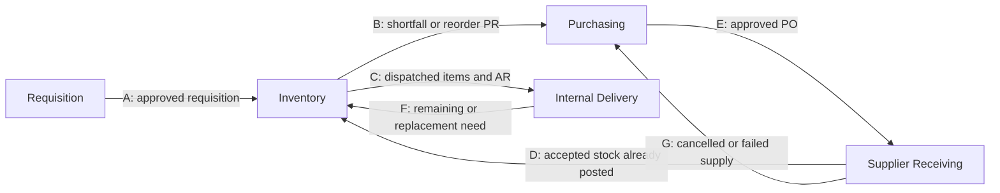

# RCWheels Systems Integration: Project Plan

Part of [[RCWheels Business Management System]].

- **Course:** PC 316 Systems Integration and Architecture 1
- **Team:** Group 5 (Mitch Andrie Amores, Ivan Rey Tagalicud, Arien Destriza)
- **Client:** RCWheels Corporation, main location at New Imus, Lorega St., San Miguel, Cebu City
- **Written:** November 2, 2026

## 1. Goal

Build a browser-based academic prototype of the system described in [[raw/clippings/Proposal_Revised.pdf|Proposal_Revised.pdf]]: one central database connecting **Requisition, Inventory, Purchasing, and Delivery** for the main location.

The client's main problems are incorrect data entry, lost requests and documents, stock records that do not match actual stock, and poor coordination between departments. The prototype should let staff follow one request from submission to acceptance, with its quantities and history kept in one place.

**Source of truth:** `Proposal_Revised.pdf`, including its seven figures. `raw/assets/RCWheels_Flowchart.drawio` (open with draw.io) has only six pages and no Inventory Reorder Point page, so it is behind the proposal. If documents disagree, follow the PDF.

## 2. Scope

**In scope**

- Digital Requisition Forms, including urgent requests and submitting on behalf of mechanics
- Separate requisition approval and purchase approval
- Stock balances, reservations, movements, approved adjustments, and item costs and values
- Manual stock deductions supported by sales records
- Item reorder points and in-system low-stock alerts
- Purchase Requisitions (PRs), Purchase Orders (POs), revisions, and supplier records
- Supplier receiving, including partial acceptance, Supplier Discrepancy Reports (SDRs), follow-up deliveries, and cancellations
- Internal dispatch, Acknowledgement Receipts (ARs), Requester Discrepancy Reports (RDRs), returns, and replacements
- In-system notifications, document attachments, audit history, and individual role-based accounts
- A simple dashboard, because the client asked for "a tracker or inventory visible at a glance" (added from the client background, not listed in the proposal)

**Out of scope**

- The other three branches, interbranch transfers, and consolidated branch inventory
- Customer dispatch, delivery scheduling, and courier route planning
- General ledger, tax, financial statements, sales processing, payments, and POS integration
- Third-party application integration and automated email notifications
- Migration of historical transactions
- Generated draft POs (optional later work)

## 3. Decisions

These choices are final for the prototype. They are based on the project documents and will not be confirmed with the instructor or client.

| # | Topic | Choice | Basis |
| --- | --- | --- | --- |
| 1 | Tech stack | Same stack as the group's `self-portrait-studio-system` project (section 4) | The team already knows it |
| 2 | Mechanic accounts | Mechanics get individual accounts and sign their own ARs | The proposal requires individual accounts and a requester signature |
| 3 | Digital signature on an AR | The signed-in user confirms; the system stores their identity and timestamp. No drawn signature | Simplest option that keeps an audit record |
| 4 | Inventory value | Moving weighted average cost, updated on accepted receipts | The proposal tracks value but names no method |
| 5 | Manager steps | Inventory Control or Monitoring Manager sets For Delivery; the requisition approver marks Fulfilled | The flowcharts say only "manager" |
| 6 | Requisition approver | Manager, department head, or boss | The proposal and October 14 interview. The October 10 background says Accounting Associates |
| 7 | Budget check | Accounting decides and records a yes or no with a reason. No budget table | No budget data is defined |
| 8 | Excess supplier quantities | Custodian holds them as disputed; Purchasing Staff record the resolution | The proposal requires an explicit decision but names no role |
| 9 | Prototype data | Fictional seed data only | The client approved the case study and testing "with limits", and those limits are not defined |
| 10 | Integration scope | Four internal modules only, with no third-party integration | The proposal's scope |

## 4. Technical approach

This stack matches the sibling project in the same course, so the team can reuse what it already knows. No RCWheels document requires it.

| Layer | Choice | Purpose |
| --- | --- | --- |
| App | Next.js App Router, TypeScript | Pages and trusted server logic in one project |
| UI | Tailwind CSS, shadcn/ui | Forms, tables, and status views |
| Data | Supabase PostgreSQL | The one central database |
| Data access | Drizzle ORM, postgres.js | Typed schema and migrations |
| Validation | Zod | Required-field and form validation |
| Auth and files | Supabase Auth and Storage | Individual accounts, plus scans of DRs and invoices |
| Tests | Vitest | Business rules and stock calculations |
| Hosting | Vercel | Browser access for testing and the demo |

**Design rules**

- **One modular app and one database.** DB1 to DB5 are role-limited access to the shared store, not separate databases.
- **Connectors A to G are workflow handoffs inside the app, not APIs.** Each handoff is a status change that puts work in the next role's queue.
- **All writes go through server-side domain functions.** The browser never sends a user ID, role, or stock figure that the server trusts.
- **Each business event runs in one database transaction.** It updates the record, stock movement, status history, audit log, and notifications together or not at all.
- **Row Level Security is enabled on every table.** This stops the Supabase public key from reading data directly; the app reaches the database only from the server.
- **History is append-only.** Corrections use linked reversals or new versions, never edits or deletes.

### Code structure

One `modules/` folder, one sub-folder per module, the same shape in every module:

```
src/
  app/                          routes only; pages import from modules
  modules/
    core/                       users, roles, audit log, notifications, attachments, dashboard, timeline
    inventory/                  items, stock events, adjustments, sales deductions, reorder alerts
    requisition/                RFs, approval, reservations, AR preparation, dispatch (the "issue" step)
    purchasing/                 suppliers, PRs, POs, Accounting review, revisions
    delivery/                   supplier receiving, SDRs, internal acceptance, RDRs, returns
  db/
    index.ts                    Drizzle client (postgres.js)
    schema/                     core.ts, inventory.ts, requisition.ts, purchasing.ts, delivery.ts, index.ts
  components/ui/                shadcn components
  lib/                          Supabase clients, auth helpers, utils
drizzle/                        generated migrations

modules/requisition/
  components/    requisition-table.tsx, requisition-form.tsx, requisition-details.tsx
  actions/       requisition.actions.ts
  services/      requisition.service.ts, issue.service.ts, requisition.service.test.ts
  repositories/  requisition.repository.ts
  schemas/       requisition.schema.ts   (Zod only)
  types/         requisition.types.ts
  index.ts
```

| Layer | Does | Does not |
| --- | --- | --- |
| `app/` page | Loads data through a service, renders module components | Hold business logic |
| `components/` | UI, forms, tables | Import repositories or the db client |
| `actions/` | `"use server"`. Gets the signed-in user, checks the role, parses input with Zod, calls one service function, revalidates | Touch the database directly |
| `services/` | Business rules and status changes. One `db.transaction` per business event | Trust a user ID, role, or stock figure from the browser |
| `repositories/` | Drizzle queries only. Every function takes `tx` so it joins the caller's transaction | Contain rules or call other modules |
| `schemas/` | Zod schemas for forms and action input (can use `drizzle-zod`) | Define database tables |
| `types/` | Shared TypeScript types for the module | |
| `index.ts` | Public API for other modules: service functions and types | Re-export components or repositories |

Structure rules:

1. **Database tables live in `src/db/schema/`, not in the modules.** The tables have foreign keys across modules, so one schema folder keeps migrations and relations in one place (same as the sibling project's `src/db/schema.ts`).
2. **Modules talk only through `index.ts`, and only to services.** Never import another module's repository or components.
3. **Dependency order, lowest first: core, inventory, requisition, purchasing, delivery.** A module imports only from modules below it, so there are no circular imports. Dispatch lives in `requisition` (it updates requisition lines and calls the inventory stock service). Supplier receiving lives in `delivery` (it calls purchasing for PO balances, inventory to post stock, and requisition to flag waiting requests for connector D). **Note:** the proposal places dispatch in the Inventory process (section 3, step 4). Only the code folder differs. The dispatch screen, the Custodian and manager roles, and connector C stay under Inventory, so users see the flow as the proposal describes it. The code sits in `requisition` because dispatch must update requisition lines and call the inventory stock service, and putting it in `inventory` would create a circular import.
4. **Only `inventory/services/stock.service.ts` changes stock balances.** Each stock event in section 7 is one function there. Other modules call it and pass their `tx`.
5. **Services and repositories start with `import "server-only"`**, and client components import from their own module by direct path, not through `index.ts`. This keeps database code out of the browser bundle.
6. **File names:** kebab-case, `<name>.<layer>.ts` (`purchase-order.service.ts`).

### Git workflow

- `main` is protected and always runs. Nobody pushes to it directly.
- One branch per feature or fix (`feat/requisition-form`), merged through a pull request reviewed by one teammate.
- Commit messages use Conventional Commits (`feat(inventory): add stock reservation`).
- The first commit contains the empty app and the folder structure above, so everyone starts from the same layout.

**Setup notes from this computer**

- Docker is not installed, so `supabase start` will not work. Use a hosted Supabase project for development.
- The local PostgreSQL 18 service is running and can hold a separate test database. It has no Supabase `auth` schema, so `users` must not have a foreign key to `auth.users`. Store the Supabase auth ID as a plain unique `uuid` column instead.
- On Vercel, connect through the Supabase connection pooler (transaction mode, port 6543) and create the postgres.js client with `prepare: false`. A direct connection runs out of connections under serverless functions.

## 5. How the modules connect



| Connector | What it does in the app |
| --- | --- |
| A | An approved requisition appears in the Inventory queue |
| B | A linked PR appears in the Purchasing queue |
| C | A dispatch and prepared AR appear in the Internal Delivery queue |
| D | Waiting requests are flagged for recheck. **It must not post stock again** |
| E | A placed PO appears in the Supplier Receiving queue with expected quantities |
| F | A remaining or replacement need returns to the Inventory queue |
| G | A cancelled balance creates a demand review in Purchasing |

## 6. Roles

| Role | Main permissions |
| --- | --- |
| Authorized employee or requester | Create RFs, track own requests, accept items, sign ARs, issue RDRs |
| Requisition approver (manager, department head, or boss) | Approve or reject RFs, mark Fulfilled, cancel remaining request balances, decide replacement or cancellation |
| Inventory Custodian | Verify stock, reserve, prepare ARs, create PRs, record sales deductions, inspect receipts and returns, issue SDRs |
| Inventory Control or Monitoring Manager | Oversee stock, approve quantity corrections, maintain reorder points, set For Delivery, review exceptions |
| Purchasing Staff | Maintain suppliers, evaluate suppliers, prepare POs, place approved orders, follow up deliveries |
| Accounting Associate | Approve or return POs, authorize PO balance cancellation, verify and approve inventory value changes |
| Delivery or Operations personnel | Assist receiving, deliver items, return rejected items |
| System administrator | Manage accounts and roles (needed for the prototype; not in the proposal) |

## 7. Data model

Start with the 28 tables in the proposal's database diagram (section 7.7). The proposal leaves keys and relationships to database design.

| Group | Tables |
| --- | --- |
| Identity and requests | `users`, `roles`, `requisitions`, `requisition_lines`, `requisition_status_history` |
| Inventory | `items`, `stock_balances`, `stock_reservations`, `stock_movements`, `stock_adjustments` |
| Purchasing | `suppliers`, `purchase_requisitions`, `purchase_requisition_lines`, `purchase_orders`, `purchase_order_lines` |
| Supplier receiving | `supplier_receipts`, `supplier_receipt_lines`, `supplier_discrepancies`, `supplier_commitments` |
| Internal delivery and returns | `dispatches`, `dispatch_lines`, `acknowledgement_receipts`, `internal_discrepancies`, `returns`, `return_lines` |
| Shared records | `notifications`, `document_attachments`, `audit_log` |

**Additions the diagram does not show**

- `purchase_order_revisions`, because approved PO versions and earlier commitments must be kept
- `users.approver_id`, because requests must route to an assigned approver
- `items.reorder_point`, plus the average cost from decision 4
- `stock_balances.is_incomplete`, for the incomplete-balance warning

Sales deductions do not need a new table. They are `stock_movements` rows with a unique source reference.

### Stock events

This table is the core of the system. Every event has a unique source reference, so it can post only once. **Available = usable on hand − active reservations.**

| Event | Usable | Reserved | In transit | Held | Damaged |
| --- | --- | --- | --- | --- | --- |
| Accept supplier receipt | +q | | | | |
| Reserve for request | | +q | | | |
| Release reservation | | −q | | | |
| Dispatch | −q | −q | +q | | |
| Requester accepts | | | −q | | |
| Item returned | | | −q | +q | |
| Return inspected: usable | +q | | | −q | |
| Return inspected: damaged | | | | −q | +q |
| Sales deduction, limited to available stock | −q | | | | |
| Sales reversal, linked to the original | +q | | | | |
| Approved adjustment | ±q | | | | |
| Return of posted stock to supplier, with value reversal | −q | | | | |

Rejected supplier goods never enter these balances; they stay on the receipt line. Uncertain returns stay in Held until reinspected.

### Quantity rules

- Each requisition line tracks requested, reserved, dispatched, accepted, returned, and outstanding quantities. These are what the system relies on; the header status only summarizes them.
- **Unissued need** = approved − accepted − in transit. Here, "approved" excludes any separately cancelled quantity.
- **Uncovered shortfall** = approved − accepted − in transit − reserved − allocated outstanding PO quantity. Create a PR only when this is above zero.
- **Reorder check:** when available ≤ reorder point, alert the Custodian and Inventory Manager. The reorder point triggers a review and is not the order quantity, so the Custodian enters the quantity after checking pending PRs and open POs.

### Statuses

Names in **bold** come from the proposal. The rest are proposed.

| Record | Statuses |
| --- | --- |
| Requisition | Pending Approval, **Rejected**, Approved, **Awaiting Stock**, **For Delivery**, Out for Delivery, **Pending Resolution**, **Fulfilled**, **Cancelled** |
| PR | Open, Covered, Cancelled |
| PO | Pending Approval, **For Revision**, Approved, Placed, Partially Received, Closed, Cancelled |
| Supplier discrepancy | Open, Agreed, Resolved |
| Internal discrepancy | **Pending Resolution**, Replacement Approved, Cancelled |

### Rules to enforce in code

1. A requisition approval never approves a purchase, and a low-stock alert never authorizes spending.
2. A PO cannot be placed until Accounting approves that exact version. A change to supplier, item, quantity, or price needs reapproval.
3. Supplier receipts post stock once, in Supplier Receiving. Stock is deducted once, at dispatch. Acceptance deducts nothing.
4. A supplier receipt alone never fulfills a requisition.
5. A requisition becomes Fulfilled only when all required quantities are accepted or the balance is separately cancelled.
6. Cancelling a requisition does not cancel a PO, and cancelling a PO does not cancel a requisition.
7. Delivery rejection uses Pending Resolution. It never changes an approved request to Rejected.
8. Stock reserved for one request cannot go to another request or an unrelated sale.
9. Balances flagged incomplete need physical verification before allocation.
10. Lock the `stock_balances` row during reservation and dispatch so two requests cannot claim the same stock. When one event touches several items, lock the rows in item ID order so two requests cannot deadlock each other.
11. Users cannot approve their own request or PO (proposed; not stated in the proposal).
12. When the server blocks an action, write the audit entry outside the cancelled transaction, or the rollback erases it.

## 8. Build phases

The order delivers the in-stock path first, then the shortage path. Inventory comes first because every other module depends on correct stock figures. Effort is relative (S, M, L), and the plan has no dates because no prototype deadline is recorded.

| Phase | Work | Finished when | Effort |
| --- | --- | --- | --- |
| **0. Prepare** | Assign phase owners. Agree on the code structure and git workflow (section 4). Create the git repository, Supabase project, and Vercel project | The empty app runs locally and on Vercel | S |
| **1. Foundation** | Schema and migrations, login, roles, app layout, audit log, notifications, attachments, seed data | Each seeded role logs in and sees only its own screens | M |
| **2. Inventory core** | Items, balances, the stock events table as domain functions, adjustments, sales deductions, incomplete-balance flag | Unit tests pass for every stock event, including duplicate and simultaneous posting | L |
| **3. Requisition and issue** | RF, validation, stock check, urgency, approval, rejection and resubmission, connector A, reservations, partial issue, AR preparation, dispatch | An approved in-stock request reaches dispatch, with stock deducted once | L |
| **4. Internal delivery** | Connector C, inspection, signed AR, partial acceptance, RDR, returns, inspection results, replacement or cancellation, connector F, Fulfilled | Scenarios 1 to 3 in section 9 pass | M |
| **5. Purchasing** | Connector B, shortfall calculation, suppliers, PO creation, Accounting review, revision loop, placing orders, connector E | A shortage produces one approved PO and no duplicate demand | L |
| **6. Supplier receiving** | Inspection against PO balances, partial acceptance, single posting, connector D, SDR, follow-up deliveries, cancellation, connector G | Scenarios 4 to 7 pass | L |
| **7. Visibility** | Reorder alerts, dashboard, and a timeline showing every linked record for one requisition | Scenario 9 passes, and one request can be traced end to end | M |
| **8. Finish** | Full scenario run, opening balance setup, bug fixes, demo script, user guide | All section 9 scenarios pass on the deployed site | M |

**Main screens**

| Module | Screens |
| --- | --- |
| Shared | Login, role-based dashboard, notifications, request timeline |
| Requisition | New RF, my requests, approval queue |
| Inventory | Item list, stock detail and movements, issue queue, AR preparation, dispatch, adjustments, sales deductions, low-stock review |
| Purchasing | Supplier list, PR queue, PO editor, Accounting review, open PO follow-up |
| Delivery | Receiving queue, receipt inspection, SDR, internal delivery queue, acceptance and AR signing, RDR, return inspection |

## 9. Testing

**Automated:** Vitest tests against the separate test database cover each stock event, the quantity formulas, status changes, and role permissions. Focus on the rules most likely to fail silently: double posting, double deduction, and stock claimed by two requests.

**End-to-end scenarios**

| # | Scenario | Expected result |
| --- | --- | --- |
| 1 | Request in stock, fully accepted | Stock deducted once at dispatch; Fulfilled after AR signing |
| 2 | Partial issue, then partial acceptance | Remaining quantity returns through F; request stays open |
| 3 | Requester rejects items; return inspected as usable, damaged, and uncertain | Pending Resolution; each return goes to the right balance and is recorded once |
| 4 | Stock shortage on an approved request | Awaiting Stock; one PR for the uncovered quantity only; request resumes after receipt through D |
| 5 | PO of 10 units; 6 accepted | 6 received and 4 outstanding; the next delivery is checked against the 4 |
| 6 | Accounting returns a PO; changed PO after approval | For Revision, then back to Accounting; no placement until reapproved |
| 7 | PO balance cancelled while the requisition still needs items | G triggers a demand review; requisition stays open until covered or separately cancelled |
| 8 | Two users reserve the last unit at the same time | Only one succeeds; the other sees the remaining availability |
| 9 | Stock falls to the reorder point with a PO already open | Alert sent; Custodian sees existing coverage; no duplicate demand |
| 10 | Same sales source line posted twice; late sales entry | Second post is refused; late entry flags the balance incomplete until verified |
| 11 | Rejected requisition corrected and resubmitted | Earlier decision stays in history; approval runs again |
| 12 | User opens or calls another role's action | Blocked on the server and recorded |

Before the project is called done, each scenario must pass on the deployed version, not only locally.

## 10. Client problems and how the plan addresses them

| Client problem | Addressed by |
| --- | --- |
| Incorrect data entry and constant backtracking | Required-field validation, one record per transaction, linked PR and PO data |
| Requests lost or forgotten | Digital RFs, role queues, status history, notifications |
| Wrong items or quantities ordered | Linked PR to PO, shortfall calculation, Accounting review |
| Stock records do not match actual stock | Movement history, physical verification, sales deductions, approved adjustments |
| Poor communication between departments | Connector handoffs, in-system notifications, shared request timeline |
| Lost documents | Document attachments linked to their source records |

The proposal claims no measured time savings. The prototype can show these controls working, but not a measured business improvement.

## 11. Risks

| Risk | Response |
| --- | --- |
| Scope is large for three students | Finish phases 1 to 4 first. If time runs short, cut phase 7 extras, then simplify cancellations, but keep scenarios 1, 4, and 5 |
| Stock logic gets spread across screens | All stock changes go through the domain functions built in phase 2 |
| Sales are not recorded promptly, so stock looks higher than it is | Incomplete-balance warning and physical verification, as the proposal states |
| Decisions in section 3 are not confirmed by the client, so the prototype may differ from real practice | Treat them as prototype assumptions and state them in the demo and user guide |
| Free hosting limits or a paused Supabase project affect the demo | Check the deployed site the day before and keep a recorded backup demo |
| Real client data enters the prototype | Use fictional data only, and keep secrets out of git |

## 12. First steps

1. Assign phase owners.
2. Create the git repository (first commit: empty app plus the section 4 folder structure), Supabase project, and Vercel project.
3. Confirm the empty app runs locally and on Vercel, then start phase 1.
