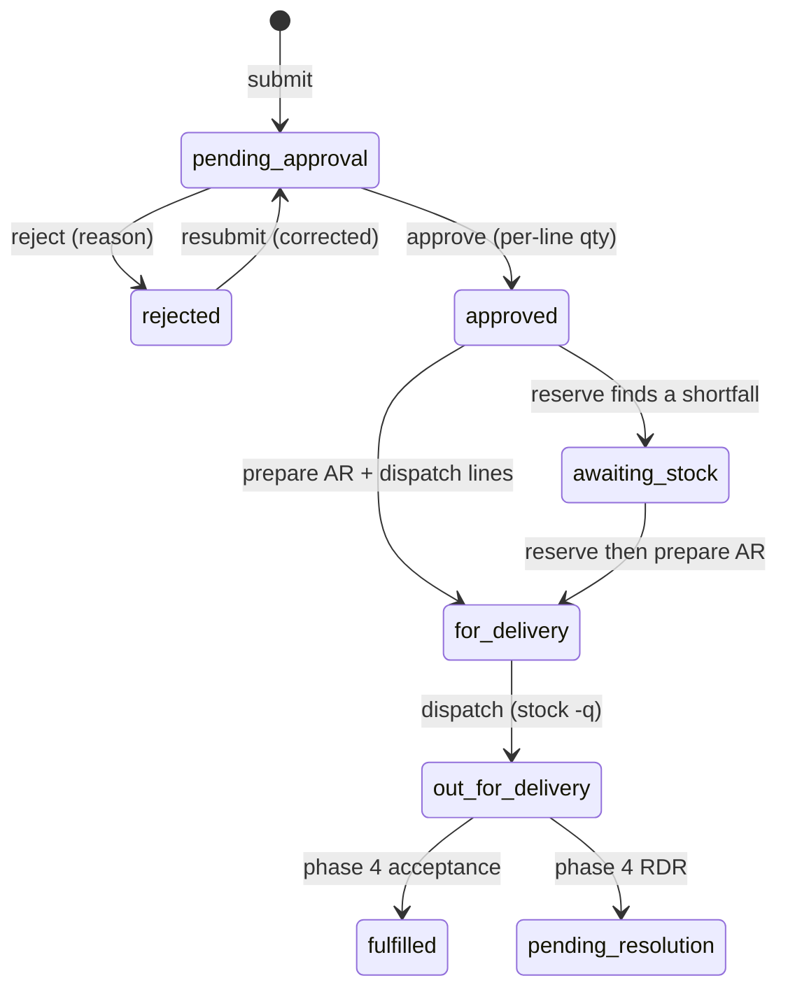

# Requisition module

How a requisition travels from a browser form to the database and back. Read it
with [PLAN.md](PLAN.md) (section 8, phase 3), [BUSINESS_RULES.md](BUSINESS_RULES.md)
(section 3, rules `BR-RQ-*`), and [ERD.md](ERD/ERD.md).

The module owns requisition forms, approval, stock reservation, AR preparation,
and dispatch. It defers acceptance, AR signing, RDRs, returns, and Fulfilled to
phase 4, and purchase requisitions to phase 5.

## Where it sits

```text
core  →  inventory  →  requisition        (purchasing, delivery come later)
```

- `requisition` imports `core` (session, audit, notifications) and `inventory`
  (stock events, quantity helpers) **through their `index.ts` only**.
- Dispatch and issue screens live under `/inventory/...` so users follow the
  proposal's process, but the code lives in this module because dispatch updates
  requisition lines and calls the inventory stock service. That is the
  documented exception in `CLAUDE.md`.

## The layers, UI to database

```text
Browser
  │  form submit (server action)          │  page request (server component)
  ▼                                       ▼
src/app/(app)/.../page.tsx            src/app/(app)/.../page.tsx
  │  require screen/user                   │  requireScreen / requireUser
  ▼                                       ▼
actions/requisition.actions.ts         modules/requisition/index.ts  (service)
  │  requireRole → DTO.safeParse            │
  ▼                                       │
services/requisition.service.ts  ◀─────────┘
  │  business rules, one transaction per event
  ▼
repositories/requisition.repository.ts
  │  Drizzle, every function takes `tx`
  ▼
src/db/index.ts  (postgres.js, Supabase pooler :6543, prepare: false)
  ▼
Supabase PostgreSQL
```

### Read path

1. A page calls `requireScreen(...)`/`requireUser()` from `@/modules/core`, so
   only signed-in users with the screen's role continue.
2. The page calls a service from `@/modules/requisition` (e.g.
   `listMyRequests`, `getRequisitionDetail`, `listPendingApprovals`,
   `listApprovedForIssue`, `listReadyForArPreparation`, `listReadyForDispatch`).
3. The service calls a repository function with the root `db` and maps the rows
   to the read DTOs (`RequisitionListItemDto`, `RequisitionDetailDto`, …).
4. The page passes DTOs to server components; no component queries the database.

### Write path

1. The form (client component) posts to a server action in
   `actions/requisition.actions.ts` with `useActionState`.
2. The action authenticates with `requireRole(...)`, parses the payload with the
   matching Create/Update DTO, and calls **one** service function.
3. The service wraps the event in `runBusinessEvent(actorId, ...)` from core,
   which opens one `db.transaction`. Repository writes, the stock movement, the
   status history, the audit entry, and the notifications all commit together
   or not at all.
4. The action `revalidatePath(...)` and returns an `ActionResult`; the form shows
   `FormMessage` (the DTO/BlockedActionError message).

On a refused rule the service throws `BlockedActionError`. `runBusinessEvent`
rolls back, writes a `blocked:<action>` audit row **outside** the transaction
(Plan rule 12), then rethrows; `actionFailure` turns it into a form error.

## DTOs

Create and update DTOs are Zod schemas in `schemas/requisition.dto.ts`. Each is
both the schema and its inferred type, so the same name validates the action
payload and types the service parameter. Read DTOs are plain types in
`types/requisition.dto.ts` (they include joined and derived fields no single
table holds).

| Kind | DTOs | Used by |
| --- | --- | --- |
| Create | `CreateRequisitionDto`, `CreateRequisitionLineDto` | `submitRequisitionAction` |
| Update | `ApproveRequisitionDto`, `RejectRequisitionDto`, `ResubmitRequisitionDto`, `ReserveRequisitionDto`, `PrepareAcknowledgementReceiptDto`, `DispatchRequisitionDto` | approve/reject/resubmit/reserve/AR/dispatch actions |
| Read | `RequisitionDto`, `RequisitionListItemDto`, `RequisitionLineDto`, `RequisitionStatusEntryDto`, `RequisitionDetailDto` | services and pages |

- Create/update DTOs are imported **by direct path** inside the module and are
  not re-exported from `index.ts` (mirrors the inventory module's treatment of
  its Zod schemas).
- Read DTO types and `requisitionStatuses` are exported from `index.ts` for other
  modules and pages.
- Validation messages live on the DTO fields and surface unchanged in the form.

## Screens and roles

| Screen | Route | Role | Service |
| --- | --- | --- | --- |
| New requisition | `/requisitions/new` | requester | `submitRequisition` |
| My requests | `/requisitions/my-requests` | requester | `listMyRequests` |
| Request detail | `/requisitions/[id]` | any signed-in (record access in service) | `getRequisitionDetail` |
| Approval queue | `/requisitions/approvals` | requisition approver | `listPendingApprovals` |
| Issue queue | `/inventory/issue-queue` | inventory custodian | `listApprovedForIssue` / `reserveRequisition` |
| AR preparation | `/inventory/ar-preparation` | inventory custodian | `listReadyForArPreparation` / `prepareAcknowledgementReceipt` |
| Dispatch | `/inventory/dispatch` | inventory custodian | `listReadyForDispatch` / `dispatchRequisition` |

`getRequisitionDetail` allows the submitter, the assigned approver, the inventory
roles, and the system administrator; anyone else gets "not found".

## Status lifecycle



Every transition appends a row to `requisition_status_history` (who, when, from,
to, reason). History is never edited.

## Tables touched

| Table | Use |
| --- | --- |
| `requisitions` | header, status, urgency, purpose, requester name |
| `requisition_lines` | requested / approved / cancelled quantities |
| `requisition_status_history` | append-only status trail |
| `dispatches` | prepared → dispatched |
| `dispatch_lines` | sent quantity per line |
| `acknowledgement_receipts` | one per dispatch, prepared by the custodian |
| `stock_reservations` | read and written through inventory stock events |
| `stock_movements` | reservation and dispatch ledger rows |
| `notifications`, `audit_log` | written by core services |

## Derived quantities (never stored on the line)

- `reservedQty` = sum of **active** `stock_reservations` for the line.
- `dispatchedQty` / `acceptedQty` = sum from `dispatch_lines`.
- `returnedQty` = sum from `return_lines` (phase 4).
- `outstandingQty` = approved − cancelled − accepted − returned.
- `in transit` = dispatched − accepted − returned.
- `unissuedQty` = approved − cancelled − in transit.
- `reservableQty` = unissued − reserved (never below zero).
- `availableStock` = the item's usable on hand − all active reservations.

The SQL lives in `repositories/requisition.repository.ts` so every screen agrees.

## Business rules implemented here

| Rule | Where |
| --- | --- |
| BR-RQ-01/02 | `CreateRequisitionDto`, `submitRequisition` |
| BR-RQ-03 | `isUrgent` stored and used for queue ordering |
| BR-RQ-04/07 | `submitRequisition` notifies the approver; approve notifies the custodian queue |
| BR-RQ-05 | per-line `approvedQty` in `ApproveRequisitionDto`, checked in `approveRequisition` |
| BR-RQ-06 | `rejectRequisition` + `resubmitRequisition` keep history |
| BR-RQ-08/09 | derived line quantities |
| BR-RQ-15 | `insertRequisitionStatusHistory` on every transition |
| BR-RQ-16 | approval never creates a purchase record |
| BR-AC-06/07 | self-approval and non-assigned approver blocked in `lockForDecision` |
| BR-IN-04/06/07/08 | reservation and dispatch rules enforced by `inventory/stock.service.ts` |

## One request, end to end

1. **Submit** — `requisition-form.tsx` posts `CreateRequisitionDto`; the action
   calls `submitRequisition`, which inserts the header (`pending_approval`), its
   lines, the first history row, an audit row, and a notification to the
   submitter's approver.
2. **Approve/reject** — the approver opens the detail from `/requisitions/approvals`
   and the `ApprovalDecision` form posts per-line `approvedQty` (or a reject
   reason). `approveRequisition` stores the quantities, sets `approved`, and
   notifies the requester and the custodian; `rejectRequisition` sets `rejected`.
3. **Resubmit** — a rejected request shows the pre-filled form again;
   `resubmitRequisition` replaces the lines, returns it to `pending_approval`,
   and appends history.
4. **Reserve** — the custodian opens the issue queue request and the
   `ReserveForm` posts quantities. `reserveRequisition` calls
   `reserveStockForLines` (inventory), which locks balances in item order and
   writes reservations. A fully reserved request stays `approved`; any shortfall
   moves it to `awaiting_stock`.
5. **Prepare AR** — the custodian names the delivery person and confirms sent
   quantities. `prepareAcknowledgementReceipt` writes `dispatches`,
   `dispatch_lines`, and `acknowledgement_receipts`, sets `for_delivery`, and
   notifies delivery operations. No stock moves yet.
6. **Dispatch** — the custodian releases it. `dispatchRequisition` calls
   `dispatchStockLines` (inventory), which deducts usable stock once and posts in
   transit, sets the dispatch to `dispatched`, and the request to
   `out_for_delivery`.

## Transactions, audit, notifications

- Every write is one `runBusinessEvent` transaction: header/lines/history, stock
  event, audit, and notifications commit together.
- `recordAudit` writes the business-event entry inside the transaction;
  `recordBlockedAction` writes refused actions outside it.
- Notifications are in-system only. Types used here: `requisition_submitted`,
  `requisition_approved`, `requisition_rejected`, `requisition_reserved`,
  `requisition_for_delivery`, `requisition_out_for_delivery`.

## File map

```text
src/modules/requisition/
├── index.ts                         # public services + read DTO types
├── types/requisition.dto.ts         # read DTOs + status union
├── schemas/requisition.dto.ts       # create/update DTOs (Zod + inferred types)
├── repositories/requisition.repository.ts
├── services/requisition.service.ts
├── actions/requisition.actions.ts
└── components/
    ├── requisition-form.tsx         # create and resubmit
    ├── requisition-table.tsx        # my requests
    ├── requisition-details.tsx      # header, lines, history
    ├── requisition-status-badge.tsx
    ├── approval-queue.tsx
    ├── approval-decision.tsx        # per-line approve or reject
    ├── issue-queue.tsx
    ├── reserve-form.tsx
    ├── ar-preparation-queue.tsx
    ├── ar-preparation-form.tsx
    ├── dispatch-queue.tsx
    └── dispatch-button.tsx

src/app/(app)/
├── requisitions/page.tsx              # redirects to /requisitions/my-requests
├── requisitions/my-requests/page.tsx
├── requisitions/new/page.tsx
├── requisitions/approvals/page.tsx
├── requisitions/[requisitionId]/page.tsx
├── inventory/issue-queue/page.tsx
├── inventory/ar-preparation/page.tsx
└── inventory/dispatch/page.tsx
```

## Tests

- `schemas/requisition.dto.test.ts` — pure DTO tests, run in CI (`npm run test:run`).
- `services/requisition.service.test.ts` — DB-backed lifecycle tests. Skipped
  unless `TEST_DATABASE_URL` is set in `.env.local`; `src/test/global-setup.ts`
  migrates that database once per run.

```bash
npm run test:run        # lint-safe; DB tests skip without TEST_DATABASE_URL
npm run test:run -- src/modules/requisition/services/requisition.service.test.ts
```

## Known deviations

- **BR-RQ-10** says the Inventory Manager sets For Delivery, while the plan's
  phase 3 and the current screen/role map let the Custodian prepare the AR and
  set `for_delivery`. Adding a separate manager gate is a follow-up.
- Phase 4 (acceptance, AR signing, RDR, returns, Fulfilled) and phase 5 (the
  shortage PR for `awaiting_stock`) are not built here.
